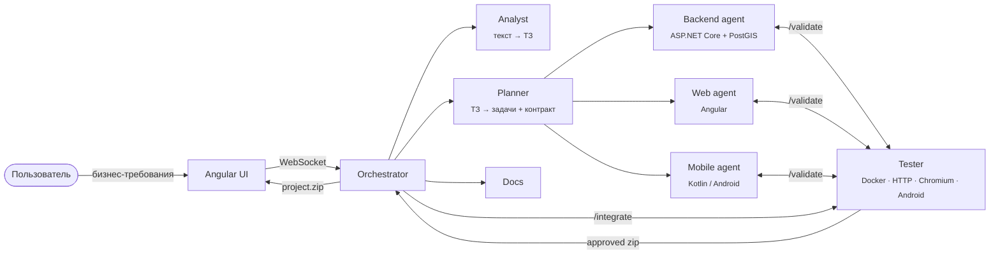

<div align="center">

# 🤖 MAS Pipeline

**Многоагентная система, которая превращает текст бизнес-требований в готовый, собранный и протестированный проект: backend, web и Android.**


*Проект хакатона по многоагентным системам (RWB, октябрь 2026)*

</div>

---

## Идея

Пользователь пишет обычным текстом, что ему нужно: «сервис заметок с заголовком и текстом», «мобильный помощник для парковки служебных авто» и т.п.
Дальше работает команда LLM-агентов, устроенная как команда разработки:

- **аналитик** составляет ТЗ;
- **планировщик** выбирает компоненты и замораживает контракт (OpenAPI, события, критерии приёмки);
- **агенты-разработчики** (Backend, Web, Mobile) пишут код;
- **тестировщик** собирает его в Docker, запускает, придумывает и прогоняет тесты, а при провале возвращает агенту обратную связь;
- **документатор** описывает то, что получилось на самом деле.

На выходе получается `project.zip` с исходниками, `docker-compose.yml`, GitLab CI/CD, мониторингом Prometheus, документацией и отчётом о покрытии требований тестами.

> Главный принцип: **принимает работу только тестировщик.** Агент не может сам объявить задачу выполненной. Архив `approved/<role>.zip` появляется, только когда код собран, запущен и прошёл проверки.

## Архитектура



| Сервис | Роль |
|---|---|
| `ui` | Веб-интерфейс (Angular 20 + Material): ввод требований, живой лог прогона, просмотр файлов. Единственный порт наружу: `8088` |
| `orchestrator` | Очередь прогонов, вызов агентов, сборка итогового архива, интеграционная проверка, отчёт |
| `analyst` | Бизнес-требования → структурированное ТЗ (user stories, сущности, API, критерии) |
| `planner` | Выбор компонентов (BACKEND / WEB / MOBILE) и замороженный JSON-контракт |
| `backend`, `web` | Агенты компонентов: teamlead → designer → developer → devops |
| `backend-coder`, `web-coder` | Отдельные кодеры для агентов (написание и исправление файлов) |
| `mobile` | Android-агент: генерация по слоям зависимостей, `assembleDebug` + unit-тесты, цикл исправлений |
| `tester` | Сборка и запуск в Docker, LLM-генерация декларативных тестов, HTTP/Playwright/UIAutomator, интеграция WEB+BACKEND |
| `docs` | Документация строго по фактическим файлам и отчётам |

## Что проверяется

| Компонент | Проверки |
|---|---|
| **BACKEND** | production Docker build, запуск с PostGIS, `/health`, HTTP-сценарии и схемы ответов по утверждённому OpenAPI |
| **WEB** | production build, nginx, Chromium (Playwright), ожидаемые тексты; финально — вместе с живым backend через proxy |
| **MOBILE** | Gradle build и unit-тесты, установка APK в эмулятор, запуск без `FATAL EXCEPTION`, проверки UIAutomator (при наличии KVM) |

`coverage.json` связывает каждый критерий приёмки с реально выполненными тестами. Если подтверждения нет, критерий получает статус `unverified`.

## Быстрый старт

Нужны Docker Engine с Compose v2 и любая OpenAI-совместимая LLM (на хакатоне использовалась Qwen).

```bash
git clone https://github.com/GorSerGit/mas-pipeline.git
cd mas-pipeline
cp .env.example .env        # заполнить LLM_URL, LLM_API_KEY, LLM_MODEL
docker compose up -d --build
```

Откройте <http://localhost:8088> → вкладка **«Генератор»** → вставьте требования → **«Запустить пайплайн»**.

Первая сборка занимает 10–20 минут (.NET SDK, Chromium, npm). Прогон WEB + BACKEND идёт 8–45 минут, в основном из-за лимитов запросов к модели.

Для проверки Android в эмуляторе нужен Linux x86_64 с `/dev/kvm` и образ раннера:

```bash
docker build -t mas-android-runner runners/android
```

Без KVM runtime/UI-тесты MOBILE помечаются `skipped` с объяснением, а сборка и unit-тесты остаются обязательными.

Подробная инструкция (Windows, туннель к модели, отключение ролей, диагностика): [docs/ЗАПУСК.md](docs/ЗАПУСК.md).
Полное техническое описание маршрута и проверок: [docs/ПОДРОБНО.md](docs/ПОДРОБНО.md).

### Конфигурация (`.env`)

| Переменная | Назначение |
|---|---|
| `LLM_URL` | Базовый URL OpenAI-совместимого API, заканчивается на `/v1` |
| `LLM_API_KEY` | Ключ к модели |
| `LLM_MODEL` | Имя модели |
| `UI_PORT` | Порт веб-интерфейса (по умолчанию `8088`) |
| `MAX_REPAIR_ATTEMPTS` | Число попыток «агент → тестер → исправление» (по умолчанию `3`) |
| `DISABLED_ROLES` | Отключить роли, например `MOBILE` |

### Развёртывание на удалённом сервере

```bash
cp .env.deploy.example .env.deploy   # REMOTE=user@host, SSH_PORT
./scripts/start_all.sh               # сборка → перенос образов по SSH → запуск → туннель к UI
```

## API

| Метод | Путь | Описание |
|---|---|---|
| `POST` | `/runs` | `{"text": "бизнес-требования..."}` → `202` + `run_id` |
| `POST` | `/orchestrate` | Запуск по готовому структурированному ТЗ |
| `GET` | `/runs`, `/runs/{id}` | История и статус |
| `GET` | `/runs/{id}/download` | Итоговый `project.zip` (`409`, пока не готов) |
| `GET` | `/runs/{id}/report` | Отчёт: план, код, каждый тест, покрытие, токены, время |
| `WS` | `/ws/pipeline` | События прогона в реальном времени |

## Структура репозитория

```
├── services/
│   ├── analyst/        # текст → ТЗ
│   ├── planner/        # ТЗ → план и контракт
│   ├── orchestrator/   # управление прогоном, итоговый архив, отчёт
│   ├── backend/        # агент ASP.NET Core
│   ├── web/            # агент Angular
│   ├── mobile/         # агент Kotlin/Android (+ сниппеты и тесты)
│   ├── tester/         # сборка, запуск и тестирование
│   └── docs/           # генерация документации
├── common/             # общий LLM-клиент и утилиты
├── runners/android/    # образ с Android SDK и эмулятором
├── ui/                 # Angular-интерфейс
├── tests/              # тесты пайплайна (unittest)
├── scripts/            # запуск, перенос образов, проверка сервисов
└── docs/               # инструкции, заметки разработки, примеры ответов аналитика
```

## Разработка и тесты

```bash
python -m unittest discover -s tests -v          # тесты пайплайна с подменёнными сетевыми зависимостями
python -m compileall -q common services
scripts/test_services.sh quick                    # health-проверки поднятых сервисов
python scripts/test_analyst.py                    # регрессия аналитика на 10 эталонных запросах
```

## Ограничения и безопасность

- Генерация недетерминирована: тот же запрос иногда проходит с 2–3 попыток компонента.
- Tester имеет доступ к Docker socket и запускает сгенерированный код. **Запускайте пайплайн только в изолированной VM.**
- UI и API без аутентификации. Не публикуйте порт в открытый интернет без отдельной защиты.

## Лицензия

[MIT](LICENSE)
